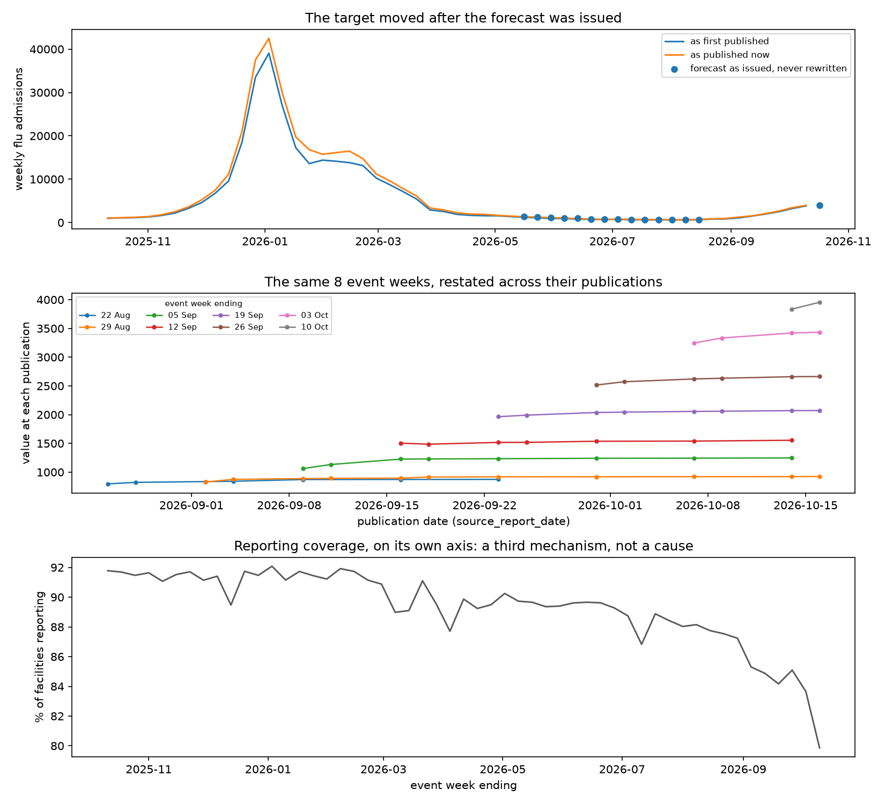

# When the Past Moves

**Revision-Aware ML Monitoring & Decision Reliability**

> **Status: the gate has been measured.** G0, G1 and G2 have run on real data and
> their figures are below. G3 is authorised by a criterion declared before the
> number that judges it existed, and has not been run. Every figure about these
> data comes from a script in this repository, is stored in
> [`reports/results/`](reports/results), and has a row in
> [`scripts/verify_results.py`](scripts/verify_results.py), which CI runs.
> Figures attributed to published work were checked against the original text;
> see [`referencias.md`](referencias.md).

---

## 1. The operational problem

A deployed model is watched by a monitor. When the monitor fires, the standard
response is to retrain — and that assumes the alarm means the world changed. But
in surveillance, macroeconomic statistics, marketing attribution and accounting
closes, **the record of the past moves too**: values arrive late, get corrected,
and are restated weeks after the period they describe. On top of that, *who
reports* changes: in this series the number of hospitals submitting data varies
week to week, and a jump in admissions can come from more of them reporting.

So an apparent degradation has several readings that call for opposite responses,
and the cheapest wrong move is to retrain a model onto a restatement.

**The question:**

> When a model is evaluated against revisable records, how much does knowing the
> revision history and the reporting coverage change the maintenance
> recommendation — and under what cost conditions is intervening justified?

## 2. Headline result

**N1 = 0.454545** — at **25 of 55** eligible weekly national decision cuts, the
recommendation under both kinds of information differs from the recommendation
under neither. Wilson 95% interval **[0.330253, 0.584773]**. No arm abstained at
any cut, so no cut is missing from the denominator.

**How it was measured.** 55 scheduled national decision cuts were replayed
against the record as it stood at each cut, never as it stands now. At every cut
the same monitor ran four times over two crossed information factors — revision
history and reporting coverage — and the four recommendations were compared.

N1 is the **discordance of recommendations**. It is not "the value of
information" — that names a specific decision-theoretic quantity this is not —
and a recommendation that changes under a counterfactual is not a false alarm.
It measures *that* the recommendation changed, not that it improved.

**Where the discordance comes from is not where the project expected.** Crossing
the two information factors separates them exactly:

| contrast | changed | of | estimate |
|---|---|---|---|
| coverage alone, D(01,00) | 25 | 55 | **0.454545** |
| revisions alone, D(10,00) | 0 | 55 | **0.0** |
| coverage given revisions, D(11,10) | 25 | 55 | 0.454545 |
| revisions given coverage, D(11,01) | 0 | 55 | 0.0 |

The revision arm reproduced the base arm's recommendation at **every one of the
55 weeks**, with and without coverage, so both interaction contrasts are exactly
**0** and the discordance is carried entirely by coverage. The 95% Wilson upper
bound on each of those zeros is **0.065285**: nothing was observed, and what
these data rule out is an effect larger than about one week in fifteen — not an
effect of zero.

**This is a result about a declared threshold, not about revisions in general —
and the grid says so plainly.** The revision alarm was fixed at 0.02 before N1
was computed, and the signal it reads spans **0.006009 to 0.016014** over the 55
evaluated weeks: its entire range falls below its own alarm, so it never fires.
At the other two points of the same declared grid it fires often, and then the
revision factor is not inert at all:

| revision alarm | revisions alone, D(10,00) | N1 at C = 0.02 |
|---|---|---|
| 0.005 | **45 of 55** = 0.818182 | 0.818182 |
| 0.01 | **14 of 55** = 0.254545 | 0.581818 |
| **0.02** (primary) | 0 of 55 = 0.0 | **0.454545** |

So "coverage carries the discordance and revisions carry none" is a statement
about the primary cell, not about this series. The primary cell is the one
declared in advance, and it is also the most conservative of the nine — which is
why it is the headline — but a reader who moves the alarm one declared step gets
a revision factor that moves more recommendations than coverage does. §10 reports
what that costs.

Backing: [`reports/results/02_discordance.json`](reports/results/02_discordance.json),
keys `primary_cell.n1_d11_vs_d00`, `primary_cell.simple_effects`,
`primary_cell.interaction_contrasts`, `signal_values_in_evaluation`. Evidence
class **E2**: a controlled replay — the forecasts are reconstructed from as-of
states, and no run issued one at these origins.

## 3. The figure



Produced by [`scripts/01_vertical_slice.py`](scripts/01_vertical_slice.py). Three
panels, no causal arrows — three series that moved:

* **Top.** The target as first published and as published now, with the point
  forecasts as they were issued and never rewritten. The two lines separate
  visibly across the whole season: the record a forecast was scored against is
  not the record that exists today.
* **Middle.** Eight event weeks, each traced across its successive publications.
  Every one of them is restated upward after first release, and the restatements
  shrink as the week ages — which is the shape §6 measures.
* **Bottom.** Reporting coverage on its own axis, falling from about 92% of
  facilities to below 80% at the edge of the series. This is the panel the
  headline result turns on, and it is also why a coverage threshold declared on
  development data turned out to be the wrong size.

## 4. The system

Six small responsibilities, one batch process, no platform.

```
sources  ──►  as-of panel  ──►  forecast  ──►  monitor  ──►  decision  ──►  evidence
(two        (what was        (immutable,    (five        (recommend,    (manifest,
 channels)   knowable at      issued once)   typed         never        hashes, run
             a cut)                          signals)      deploy)      record)
```

Two doors and no others: [`src/revmon/sources.py`](src/revmon/sources.py) is the
only module that touches the network, and
[`src/revmon/panel.py`](src/revmon/panel.py) the only one that reads `data/`.
The project's central quantity is *what was knowable when*, so a second route to
the data would be a second definition of that quantity — which is how a
look-ahead gets in without anyone seeing it.

### The as-of contract

Every read is bounded by a decision cut, in one of three modes: `PUBLIC_REPLAY`
(only versions the source declared published before the cut), `OBSERVED_REPLAY`
(and that this system had actually fetched by then), and `LIVE`. Because the
source's publication date has day granularity and no verified hour, a public
replay places the cut a day after the declared publication rather than claiming
same-day visibility.

The gate refuses to invent: when the history needed for a cut is missing it
returns `INCOMPLETE_HISTORY`, and the monitor is allowed to `ABSTAIN`. It is
enforced in the data path and checked with generated histories rather than a
handful of examples — the invariant is universal, so the test is too.

A monitor and a forecaster need different shapes of the same history, so
`visible_triangle` returns every version visible at a cut and `as_of_view` is
built on top of it. One visibility rule, two shapes: two implementations of it
would be two definitions of what was knowable.

## 5. The model being monitored, and why it is the naive one

A monitoring study needs a model worth monitoring, so the candidate was chosen by
measurement rather than by assumption. Over **55 distinct target weeks**, mean
scaled absolute loss:

| model | mean scaled loss | beats M0 | loses to M0 |
|---|---|---|---|
| **M0**, seasonal-naive | **0.314624** | — | — |
| ridge, lagged features | 0.378141 | 8 | 47 |
| ridge, minimal features | 0.602930 | 8 | 47 |

**M0 stays the Champion, and nothing was promoted.** That is a negative result
and it is reported as one: the promotion rule was declared in the G1-MP plan
before the comparison ran, no candidate met it, and the later phases that would
have retrained and deployed a challenger therefore have no object. The
alternative — adding candidates until one wins — is the failure mode this
project's scope rule exists to prevent.

Loss is scaled absolute error with a fixed `s_dev` of **4967.25**, computed over
**24** calibration pairs in a retrospective window (2024-11-19 to 2025-06-30) and
never updated with the future. WIS is deliberately not used: the FluSight hub
scores quantile forecasts over 23 quantiles, this prototype emits points, and
borrowing that rule would mean producing quantiles for prestige.

The denominator is one row per distinct target week, keeping the earliest origin
at which that week became forecastable: **61** eligible origins collapse to
**55** weeks. When publication stalls, several origins forecast the same week
from the same state, and counting origins would weight that week once per origin.
The rule is a calendar rule, so which row survives cannot depend on which one
scored better.

**The product is a nowcast, not a forecast.** At horizon +1 with this publication
lag, the target week has always already begun when the forecast is issued — the
one observed run is an `intra_week_nowcast`, and the emission class of every
stored prediction is audited rather than asserted. Publication lag runs from a
median of **7** days to a maximum of **49**, so the effective horizon varies even
though the recipe is fixed at +1.

Backing: [`reports/results/01_model_comparison.json`](reports/results/01_model_comparison.json)
and [`reports/results/01_modeling_support.json`](reports/results/01_modeling_support.json).

## 6. The two signals, and the one that had to be replaced

Before crossing R and C it is worth asking whether either can take more than one
value. One of them could not.

**The revised share is saturated.** Across **1046** comparable publication pairs
in the development triangle, **1046** were revised — a revised share of **1.0**,
and not only at short lags:

| publication lag, days | pairs | revised share | median abs. relative revision |
|---|---|---|---|
| 0–7 | 33 | 1.0 | 0.037626 |
| 8–14 | 62 | 1.0 | 0.012175 |
| 22–28 | 53 | 1.0 | 0.001647 |
| 91–180 | 167 | 1.0 | 0.000326 |
| >180 | 359 | 1.0 | 0.000625 |

This source restates every value at every publication, out past 180 days. So "has
this week been revised?" is a question whose answer is always yes, the share is
constant **1.0** under both anchorings, and **a factor that takes one value is
not a factor**. Crossing it with coverage would have produced a discordance that
was an artefact of the saturation.

The *size* of the restatements is a different quantity, and it does vary: the
median falls from **0.037626** at a week's first restatement to **0.000326** past
90 days, and the per-cut mean takes **31** distinct values over 32 development
cuts. A saturated share and a varying magnitude are logically independent — there
is a test that holds a frame where every pair is revised while the sizes differ by
two orders of magnitude — so replacing one with the other is a **change of
signal**, not a rescaling of the same one.

**Decision C**, registered in [`config/g2_signals.json`](config/g2_signals.json):
R becomes the mean absolute relative restatement over the same window. The file is
sealed into every run that reads it as `selection_config_sha256`, and it was
written **before any discordance was computed** — `02_discordance.json` did not
exist and no arm had emitted a recommendation at any cut. A SHA-256 proves
identity of content, not date of predeclaration; the ordering claim rests on the
commit sequence and is labelled as such.

**The coverage alarm had the mirror-image defect.** G1 declared it at 2.0
percentage points. G2-A measured the observed maximum at **0.1187** points at the
series edge and **0.033225** anchored to matured weeks — between roughly 17 and
60 times smaller than the alarm, which therefore could never have fired. It was
retired and re-declared at 0.02, just above the development p90.

**What was deliberately not changed, and why.** The performance alarm stays at
2.0 and the recent-loss signal keeps averaging over every matured label rather
than a recent window. Both are real defects. They are left in place because the
evaluation-period loss distribution had already been seen while reading the model
comparison: any value chosen now would be chosen *having looked*, and a threshold
with worse provenance is worse than an insensitive one. The consequence is
declared in the config and visible in §7 — no arm ever recommends
`EVALUAR_REENTRENO`.

**The historical record is not rewritten.** The one real run, on 2026-10-17,
recommended `INVESTIGAR_DATO` with the reason *"100.0% of recent comparable pairs
were revised, above the declared 25%"* — that is, on the saturated signal, before
G2-A measured it. The run stands as what the system recommended at the time, and
the measurement that retired its signal stands beside it.

Backing: [`reports/results/02_signal_diagnostics.json`](reports/results/02_signal_diagnostics.json),
32 development cuts ending 2025-06-30. That artefact **declares no threshold**:
it measures distributions, and the thresholds are declared separately in the
config above.

## 7. The 2x2, and what it measured

Two information factors, crossed, with everything else identical at the same cut:
**R** (revision history available) and **C** (coverage indicators available).

| | no C | with C |
|---|---|---|
| **no R** | `d_00` base | `d_01` |
| **with R** | `d_10` | `d_11` |

Crossed rather than chained, because a sequential ablation measures the
contribution of coverage *conditional on* having added revisions first, and that
number depends on the order. Crossing removes the order dependence and makes the
interaction observable — and if coverage only helps when revision history is
absent, the specialised monitor is redundant, which is a publishable finding.

**What each arm recommended**, over the 55 weeks:

| action | `d_00` | `d_10` | `d_01` | `d_11` |
|---|---|---|---|---|
| CONTINUAR | 45 | 45 | 20 | 20 |
| ESPERAR_MADUREZ | 10 | 10 | 10 | 10 |
| INVESTIGAR_DATO | 0 | 0 | 25 | 25 |
| EVALUAR_REENTRENO | 0 | 0 | 0 | 0 |
| ABSTENERSE | 0 | 0 | 0 | 0 |

The contingency says where the discordance sits: of the **45** weeks at which the
base arm said CONTINUAR, **25** became INVESTIGAR_DATO once coverage was
available and 20 did not; the **10** ESPERAR_MADUREZ weeks were unmoved. Because
`d_10` equals `d_00` at every week and `d_11` equals `d_01` at every week, the
weeks that make N1 discordant are *the same weeks* that the coverage-only
contrast flags — not merely an equal number of them.

**The verdict does not depend on the threshold cell; the estimate does.** N1 was
computed over the nine cells of the declared alarm grid and ranges from
**0.454545** to **0.818182**. The primary cell is the lowest of the nine, so the
headline is the least favourable reading, and the gate opens in all nine — that
part is robust. But the spread is wide, and §2 shows that *which factor* the
discordance is attributed to flips across the grid even though the gate does not.

**The denominator is exogenous.** It is fixed by source, model and data — an
as-of state exists, is complete, a naive forecast is producible, and the target
label has matured — never by what any arm decided. Requiring all four arms to
emit a "normal" decision would be conditioning on a post-treatment variable, and
then the information being measured would select its own denominator.
`ABSTENERSE` is a category, counted and reported even though it is **0** here.
Support: **68** candidate cuts, **61** eligible origins, **55** distinct weeks
after the calendar collapse, against a declared minimum of 20.

**What the cross does not claim.** This is an ablation of *decision information*,
not a causal partition. Freezing an aggregate coverage figure does not reconstruct
a world in which the same hospitals reported; aggregate data cannot say which
facilities stopped reporting or how many admissions they would have contributed.
Discordance is a non-additive functional of the four arms, so the two interaction
contrasts need not coincide, neither is a linear interaction term, and they are
not summed.

## 8. Consequences and the cost frontier

**Authorised, not yet run.** The criterion was written into the config before N1
existed: G3 proceeds if N1 is estimable at the primary cell **and** its Wilson
lower bound exceeds 0.10. The measured lower bound is **0.330253**, so the gate
opens. The bound is used rather than the point estimate so that a large estimate
on thin support cannot open it.

When it runs, four maintenance policies are simulated as complete trajectories
from the same initial state: never retrain, periodic, reactive to mature error,
and revision-and-coverage aware. Retraining changes the model, and the model
changes later predictions, errors and alarms, so applying one alarm vector to
four policies would invalidate the comparison. G3 carries **two** information
configurations rather than four, because the measured interaction is 0 and a
third would separate branches the measurement says are the same branch.

The output is a **region of costs**, not a number: `L_p(c) = e_p + c·r_p`, with
`c` in units of predictive loss per period — not money and not health. A single
break-even `c*` is reported only where the crossing is positive and stable, and
never as "dollars saved".

## 9. The decision this would support

A section, not a casebook, and labelled **E3 — a proposal**. The monitor shows
degradation while the evaluated records were revised and coverage moved. Four
functional perspectives — data steward, data scientist, model owner, operations —
weigh continuing, waiting for maturity, investigating the data, or evaluating a
candidate. **No meetings happened, nobody approved anything, and no organisation
adopted this.** The scenario is anchored in the run the pilot actually executed on
2026-10-17 — which recommended `INVESTIGAR_DATO` on a coverage drop of **4.5875**
points with **28** matured labels behind its loss reading — and the parts that are
proposals say so.

## 10. Where it fails

Not optional, and written with the results rather than after them.

**The coverage threshold was declared on an unrepresentative window.** Its
development ceiling was **0.033225** points; in the evaluation period the same
signal reaches **2.82**. A threshold set just above the development p90 therefore
sits far below the scale it was applied to, and it fires at 25 of 55 weeks. The
discordance is real, but its *size* is a property of a threshold chosen on data
that did not look like the period it was used on. It was not re-declared after
the fact, because re-declaring having seen the answer is the error that would
make the whole measurement unusable.

**The revision factor never fires at the primary alarm, and fires constantly one
step below it.** Its evaluation range, 0.006009 to 0.016014, falls *between* two
points of its own declared grid: entirely below 0.02, entirely above 0.005. The
consequence is the sharpest limitation in this report — the revision factor moves
0 of 55 recommendations at 0.02, **14 of 55** at 0.01 and **45 of 55** at 0.005.
Nothing in the data chooses among those three; the choice was made in advance from
a development distribution, and §2's finding inherits it. A reader who wants one
sentence should take this one: **the discordance is robust, its attribution to
coverage is not.**

**No arm ever recommends retraining.** `EVALUAR_REENTRENO` is emitted **0** times
by all four arms, which is what the config predicted in writing before N1 was
computed: the performance alarm is insensitive, and it was left that way on
purpose because the evaluation-period losses had already been seen. So the
discordance measured here is entirely CONTINUAR against INVESTIGAR_DATO — a
cheaper disagreement than the one the project set out to study, and the expensive
branch was never exercised.

**The delayed-publication stratum is empty by construction, not by measurement.**
Keeping the earliest origin for each target week keeps the shortest lag, so the
deduplicated rows cannot populate a delayed stratum. Both the deduplicated and
undeduplicated readings are reported, and neither supports a claim about how
discordance varies with effective horizon.

**55 rows are not 55 independent observations.** Consecutive weeks share state,
the same restatement pattern touches several of them, and the effective sample
size is smaller than the row count. The Wilson interval prices binomial
uncertainty, not dependence, so it is an understatement of the real uncertainty.

**And the interval is not the one the standard reference would pick at this n.**
Wilson was declared in `config/g2_signals.json` and sealed before the discordance
was computed; it is used because the Wald interval has zero width when the
observed proportion is 0 or 1, which is elementary algebra rather than a borrowed
claim. Brown, Cai and DasGupta (2001) reject Wald in exactly these terms — its
coverage is *"poor for p near 0 or 1"* — but recommend Wilson *"for small n"* and
Agresti–Coull *"for practical use when n ≥ 40"*, noting the two are *"very
similar"* at that size. With 55 weeks this project is in the second regime, and
it keeps Wilson anyway: swapping the interval after seeing the number is the
error that pre-declaring it exists to prevent. The trade is declared, not hidden.

**This is a replay, not an operating history.** G2 is **E2**: the forecasts are
reconstructed from as-of states. A replay built today does not demonstrate that
this system ran then. Exactly one prediction in this repository was issued by a
live run; the rest are replays, and the emission audit distinguishes them.

**Maturity delays everything.** A week ending cannot be scored until the declared
45 days have passed, so the most recent weeks are never available to the
evaluation that would act on them — which is itself the operational problem the
project is about, appearing inside the measurement of it.

## 11. Reproduce

```bash
uv sync --locked --extra dev        # builds .venv from the committed uv.lock

uv run ruff check .
uv run pytest
uv run python scripts/verify_results.py
uv run python scripts/weekly_capture.py   # one capture; leaves a dated record
```

Everything runs inside `.venv`, built from the committed `uv.lock`. CI, the
scheduled job and the container all install with `--locked`/`--frozen`, so drift
between the lockfile and `pyproject.toml` fails the build rather than quietly
resolving a different set of versions: a figure produced under other versions is
not the same figure.

The analysis scripts run in order and each writes one artefact:

| script | artefact | gate |
|---|---|---|
| `00_source_feasibility.py` | `00_source_feasibility.json` | G0 |
| `01_vertical_slice.py` | `01_vertical_slice.json`, the figure | G1 |
| `01_modeling_support.py` | `01_modeling_support.json` | G1-MP P0/P1 |
| `01_compare_models.py` | `01_model_comparison.json` | G1-MP P2 |
| `02_signal_diagnostics.py` | `02_signal_diagnostics.json` | G2-A |
| `02_discordance.py` | `02_discordance.json` | **G2** |

**External access.** The Delphi V5 channel reads its key from the
`DELPHI_EPIDATA_KEY` environment variable — the client picks it up from the
environment, so it is never passed as an argument and cannot surface in a
traceback or a provenance record. Put it in an untracked `.env` at the repository
root and let `uv` load it:

```bash
echo 'DELPHI_EPIDATA_KEY=...' >> .env     # .env is gitignored
export UV_ENV_FILE=.env                   # or: uv run --env-file .env ...
```

Anonymous access is capped at 60 requests per hour and allows multiple
selections on at most two parameters; a free key lifts both and is obtained from
Delphi's registration form. The hub channel needs no credentials. Source archives
are not redistributed here, so the capture step comes first.

*Processing is Python over flat files, so there are no SQL queries, entity
relationship diagram or interactive dashboard to show. Development was carried
out with AI assistance (Claude Code); every figure cited was produced by the
scripts in this repository, and every published claim was verified against its
primary source.*

---

## 12. Data, and what the sources actually guarantee

**Delphi Epidata V5, `source="nhsn"`** is the canonical channel. Target
`confirmed_admissions_flu_ew` (CDC field `totalconfflunewadm`), weekly, week
ending Saturday. Coverage comes from the `hosprep_*` family:
`hosprep_confirmed_admissions_flu_ew` is *"Number of acute care hospitals
reporting influenza admissions"* — a facility count, not an admissions count.
`/archive/` carries version history, `/snapshot/` reconstructs a past state, and
`/metadata/report_times/` lists the source's publication calendar. Access goes
through `epidatpy`, Delphi's own client, because the V3/V4 methods are being
deprecated as of October 2026 and reimplementing the wire protocol would buy
nothing.

**The FluSight hub's git history** is a second, independent reconstruction of
what was published when. A commit is evidence of what the hub put in its own
repository; it is **not** the instant a value became available from NHSN, and not
an independent epidemiological measurement. The two are compared, never fused.

### What G0 measured

Run dated **2026-10-16**, verdict **PROCEED**, 13 requests. Every figure below is
in [`reports/results/00_source_feasibility.json`](reports/results/00_source_feasibility.json)
with the query that produced it, and has a row in `scripts/verify_results.py`.
Three of them replace assumptions the framing had carried.

**Data coverage is not version coverage, and the gap is a factor of three.**
`reference_time` reaches back to **2020-08-08** — **322 weeks** of events — but
the recoverable `report_time` history starts only at **2024-11-19**: **99 weeks**
of versions. **223 event weeks have no version history at all.** Confusing the
two is precisely the error this project studies, and it would have overstated the
usable archive threefold.

**The eligible universe is settled by that, not by a judgement call.** The
archive begins 18 days after hospital reporting became mandatory again
(2024-11-01, under a CMS requirement, after a voluntary period from 2024-05-01 to
2024-10-31 that CDC flags as possibly not fully representative). So the worst
available confounder — a regime change moving coverage without moving the
phenomenon — **has no version history to contaminate**. The declared universe
describes what exists rather than excluding something.

**`/archive/` is neither of the two things its documentation says.** Delphi's V5
overview calls its rows diffs; the client's docstring says every version of every
value. Measured over a window with both axes bounded (2025-09-01 to 2026-10-10):
**100 of the 102 publications in that window carried a row** for this signal, and
a given event week appears in **17 of them** at the median — minimum 2, maximum
41. So unchanged republications are *not* omitted, and keys are *not* present in
every publication: **each release restates a trailing window of weeks.** The
revision-rate denominator therefore has to be publication pairs in which the key
appeared on both sides, which is what the rule already said and now has a
measurement behind it. Reconstructing a snapshot from the archive reproduced the
direct `/snapshot/` **exactly at all three test cuts** — zero value mismatches,
zero one-sided keys.

**Publication is not weekly.** The calendar holds **189 release dates**, a median
of **2 per ISO week** and a median of **2.5** days apart. The previous design treated
one hub commit as one publication; that proxy undercounts by roughly half, so the
revision rate built on it was a looser lower bound than the framing claimed.

**The two channels agree, on values.** The hub's national series and the V5
snapshot overlap on **245 weeks and disagree on none**. That validates the value
series; it says nothing about timing, which is a separate question and the reason
`hub_commit_at` and `source_report_date` stay separate clocks.

**And the ceiling was known before G2 ran: 99 weekly national cuts.** That is the
largest denominator N1 could have had before maturity and label availability
pruned it; the realised denominator is 55. It was reported as a ceiling, never as
an achieved sample size, and it is why the minimum support N1 needs was declared
before G2 rather than judged after. Of **100** candidate scheduled cuts, **93**
are temporally eligible under the declared 45-day maturity policy.

**Maturity is declared, not inherited.** An earlier version of this project
carried `MATURITY_DAYS = 45`, taken from Delphi's documented behaviour on a
different series; it has been removed, because it had started to read as a
property of this target. A maturity policy is supplied explicitly, says where it
was declared, and is reported against the pre-declared grid of 45/60/90 days.
Delphi documents that roughly 20% of values in the preceding two months are
revised, with a median difference near 2% — used here as a **control on the
reconstruction**, not as a result of it. In this archive the revised share is
1.0, which is a stronger statement about a different series and is reported as
the measurement it is.

## 13. Build order, and the gate

| Gate | Produces | Status |
|---|---|---|
| **G0** | Measured source windows, `archive`→`snapshot` reconstruction, cross-channel discrepancy table | **Done** — PROCEED |
| **G1** | One real run end to end, and the figure | **Done** — plus P0–P2 of the G1-MP plan; no candidate promoted |
| **G2** | **The gate.** N1 and the 2x2, with uncertainty and limits | **Done** — N1 = 0.454545, gate opens |
| **G3** | Policy trajectories and the cost region | **Authorised, not run** |

Each delivery stands on its own. Had G2 found the discordance small, the support
insufficient or the missing periods dominant, that would have been the result:
the project would have published why specialising is not justified and closed
short. **No configuration was searched until something fired, and the scope is
not widened to rescue a gate.**

The method is frozen before the confirmatory cohort is scored, and the freeze
needs two bounds: an external value embedded in the act gives a lower bound,
while an RFC 3161 timestamp or a *completed* OpenTimestamps proof gives the upper
one. A commit date of our own is not evidence — the committer date is an
environment variable. **The freeze has not yet been performed**, and the
confirmatory cohort is protected for now only by the fact that those weeks have
not happened.

## 14. Scope & caveats

**Declared in advance, because these are scope decisions rather than results.**

* **No platform layer.** No Kubernetes, Databricks, orchestrator, feature store
  or managed cloud ML. Scoring is a batch job in a container, scheduled by GitHub
  Actions. The mapping to a managed platform is described, not built: a shallow
  version of the other half would demonstrate less than saying where the line is.
* **No model-lifecycle machinery.** No registry, promotion gate, automated
  rollback or incident subsystem. A retraining policy needs a function that
  refits and a manifest.
* **No causal attribution.** Revision, coverage and genuine change are not three
  exclusive causes identifiable from aggregate data. §2 says coverage carries the
  discordance in the arithmetic of the cross; it does not say coverage caused the
  underlying movement.
* **One national decision per week.** Fifty states are not fifty replicates of a
  decision about one national model, so state rows characterise the data and do
  not enter N1's denominator. The support is small and is reported as such.
* **Forecast accuracy is not the headline.** The hub already runs that
  competition — it scores quantile forecasts with relative WIS over 23 quantiles,
  which is why this prototype, which emits point forecasts, does not borrow that
  rule for prestige. No forecast is submitted and no advantage is claimed.
* **A declared cost is not an observed one**, and `c` excludes the cost of
  investigating, of waiting, and of everything this loss function does not model.
* **One season, one disease, one country.** The procedure transfers; the
  magnitudes do not. The closest executed antecedent (Agyekum and Obese, 2026)
  finds real-time versus revised accuracy differences *"small and …
  indistinguishable under Diebold-Mariano tests"*, so the expectation here was
  modest and written down before measuring.
* **Not clinical.** Public data, a hypothetical organisation, no CDC endorsement,
  no patient or public-health decision.

### Three things this project says out loud

* The extra information changed 25 of 55 recommendations — **and that alone does
  not mean it improved them.** Nothing here measures whether investigating the
  data was the better call.
* Aggregate coverage movements were **not** read as admissions caused by
  hospitals that stopped reporting; those per-facility data are not held.
* A recommendation to retrain is **not** an automatic update of a production
  system: the consequences were compared in a validated replay, with no claimed
  approvals and no deployment.

## 15. Primary sources

Verified by opening the source; see [`referencias.md`](referencias.md) for the
full list, the works consulted and not used, and the corrections that this
verification produced — which are recorded, not deleted.
